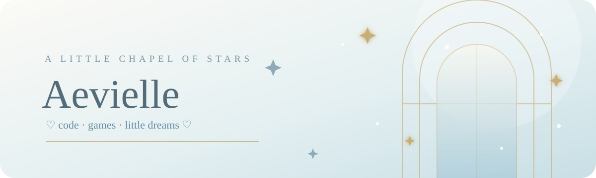

# ♡ A E V I E L L E

### `✧ a little soul wandering between code and distant worlds ✧`

*Welcome to my little corner of the internet.*

---

## ♡ A little about me

Hello, dear visitor! I'm Aevielle — a beginner developer learning to turn curious ideas into little creations.

- ✧ Exploring **Python** and **Discord bot development**
- ☾ Learning web development with **HTML, CSS, and JavaScript**
- ♡ Interested in game testing, creative projects, and digital communities
- ✦ Always learning something new, one little step at a time

> *"Even the quietest little light can brighten a whole room."*

## ✧ My little skill collection

## ☾ Beta testing archive

*A small collection of game worlds I've had the chance to explore through beta-testing experiences.*

| Game | A little note from the experience |
|---|---|
| **Duet Night Abyss** | Explored early gameplay systems and got a feel for the combat flow. |
| **Genshin Impact** | Tried character abilities, elemental interactions, and world exploration. |
| **Wuthering Waves** | Focused on movement, dodging, combos, and Resonator combat. |
| **Honkai Impact 3rd** | Experimented with Valkyrie playstyles and action-stage pacing. |
| **Honkai: Star Rail** | Explored turn-based battles, team combinations, and progression systems. |
| **Zenless Zone Zero** | Tried Agent rotations and combat timing in its stylish urban setting. |
| **Arknights: Endfield** | Got a first look at its world, systems, and strategy-focused mechanics. |
| **MONGIL: STAR DIVE** | Explored combat encounters and creature-collecting elements. |
| **Neverness to Everness** | Looked around its urban world and experimented with its supernatural features. |

## ☾ GitHub constellation

*Little steps, little commits — my coding journey keeps growing. ♡*

## ✦ Little creations

| Project | What it is | Stack |
|---|---|---|
| **Discord Bot Collection** | Experiments with commands, automation, and community tools. | Python · discord.py |
| **Aevielle's Little Website** | My personal corner of the internet. | HTML · CSS · JavaScript |
| **Moonlit Utilities** | Small tools and experiments made while learning. | Python |

*Some projects are still works in progress. I'll add repository links as they become available.*

## ♡ Find me among the stars

*Thank you for stopping by. May your days be gentle. ♡*

`✧ keep learning · keep creating · stay kind ✧`

