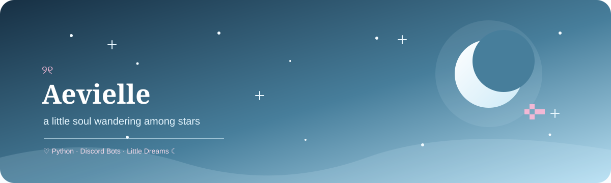

<!-- Aevielle's Moonlit Corner | Icy Blue Edition -->

  

  <em>☾ a little soul wandering among stars ୨୧</em>

  
  
  

---

## ☁️ A little about me

Hello, I'm **Aevielle** ♡

I enjoy exploring ideas, writing Python, and building little things that make digital spaces more fun.

- 🩵 Interested in Python development and Discord bots.
- ☾ Exploring `discord.py` and bot-building projects.
- ✧ Learning something new, one line of code at a time.
- ♡ Drawn to soft skies, tiny details, and creative experiments.

> *"Even the quietest moon leaves silver on the sea."* ☾

---

## 🛠️ Little toolkit

  

  Tools I use or am exploring — this list can grow with me.

---

## 🩵 Featured projects

> Replace these examples with your real repositories.

### ♡ [Project name one](YOUR_PROJECT_REPOSITORY_URL)

A short description of what this project does, what inspired it, and what someone can use it for.

`Python` · `Add relevant tools`

### ☾ [Project name two](YOUR_PROJECT_REPOSITORY_URL)

Describe a Discord bot, automation tool, or another experiment you want to showcase.

`Python` · `discord.py`

### ✧ [Project name three](YOUR_PROJECT_REPOSITORY_URL)

A short description of another project, contribution, or work in progress.

`Add your tech stack`

---

## 📊 GitHub constellation

  

  

---

## 🌙 In my little universe

- 🔭 Working on: `Add your current project`
- 🌱 Learning: `Python · discord.py`
- 💭 Exploring: `New ideas and tiny experiments`
- 🎯 Next goal: `Add a goal when you're ready`

---

## 💌 Find me

  

  <em>Thank you for visiting my little corner of the internet ♡</em>
   
  ☁️ keep coding, keep dreaming, keep shining ✧

